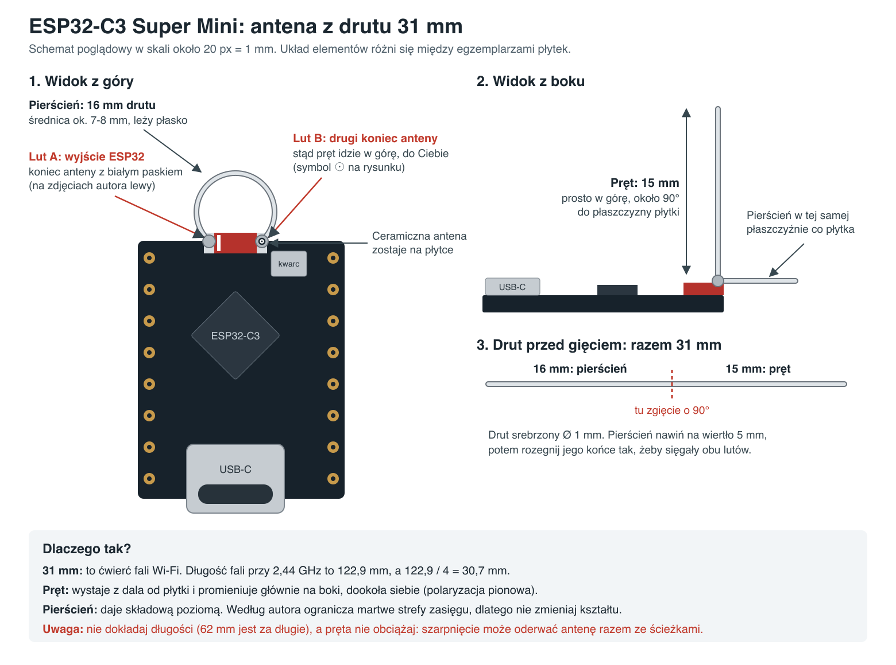

# ESP32-C3 Super Mini wire antenna

Design by [Peter Neufeld](https://peterneufeld.wordpress.com/2025/03/04/esp32-c3-supermini-antenna-modification/). He reports 6–10 dB more signal on his own RSSI logger; no independent lab measurement found. It does not help every board: some users still got handshake errors with it.

## Build

1. Cut 31 mm of 1 mm silver-plated wire. Copper works too, the author says it is less conductive and oxidizes.
2. Wrap the first 16 mm around a 5 mm drill, then widen the ends to reach both antenna terminals (about 7–8 mm across).
3. Bend the remaining 15 mm up at about 90°.
4. Solder the loop start to the ESP32 side of the ceramic antenna, usually the end with the white mark. Solder the bend with the rod to the other end. Leave the ceramic antenna in place.

Keep other modules and metal away from the antenna. Do not load the rod: one user tore the ceramic antenna off the board, traces included.

## Why this shape

- **31 mm:** a quarter wavelength. At 2.44 GHz the wavelength is 299.8 / 2.44 = 122.9 mm, a quarter is 30.7 mm (**CALC**). The author tuned 31 mm by RSSI comparison and warns that 62 mm is far too long. On a board with a 4 mm antenna trace he uses 27 mm, since the trace counts toward the length.
- **Rod:** stands clear of the board, which the stock antenna does not. A straight vertical wire radiates mostly sideways with vertical polarization.
- **Loop:** adds a horizontal element. The author says it reduces dead spots in the radiation pattern, and that the shape should not be changed. This is his explanation, not a measured pattern.
